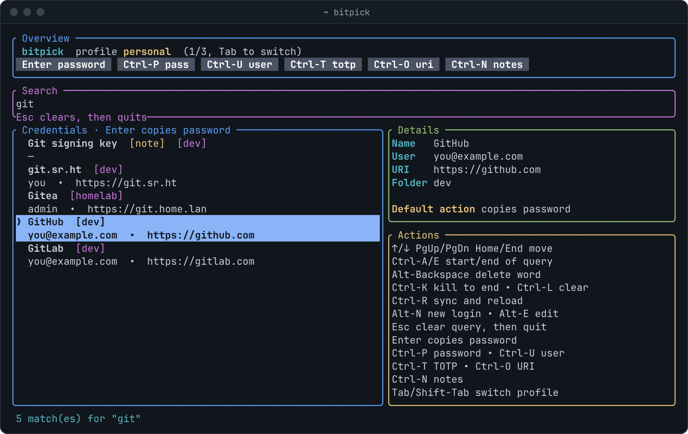

<picture>
  <source media="(prefers-color-scheme: dark)" srcset="./img/logo-dark.svg">
  
</picture>

[![Crate][crate-image]][crate-url]
[![Build Status][github-actions-image]][github-actions-url]
[![Test coverage][codecov-image]][codecov-url]
[![MIT license][license-image]][license-url]

[crate-image]: https://img.shields.io/crates/v/bitpick-cli?style=flat-square
[crate-url]: https://crates.io/crates/bitpick-cli

[github-actions-image]: https://img.shields.io/github/actions/workflow/status/aesy/bitpick/ci.yml?branch=main&style=flat-square
[github-actions-url]: https://github.com/aesy/bitpick/actions

[codecov-image]: https://img.shields.io/codecov/c/github/aesy/bitpick?style=flat-square
[codecov-url]: https://codecov.io/github/aesy/bitpick

[license-image]: https://img.shields.io/github/license/aesy/bitpick?style=flat-square
[license-url]: https://github.com/aesy/bitpick/blob/main/LICENSE

Fast terminal picker for Bitwarden credentials using `rbw` and `fzf`. `bitpick` is available as a native single-binary
Linux/macOS/Windows CLI tool.

[Visit the website](https://aesy.github.io/bitpick/) to see what it can do.



## Implementation notes

- The interface is built with `ratatui` + `crossterm`.
- Searching is delegated to `fzf --filter`.
- Clipboard on Linux/BSD uses `wl-copy` / `xclip` / `xsel` first and falls back to `arboard`, which then keeps a small background process alive to serve the copied value. On macOS and Windows `arboard` comes first, with `pbcopy` / `clip.exe` as fallback.
- Vault access uses [`rbw`](https://github.com/doy/rbw), an unofficial Bitwarden client whose background agent keeps the vault unlocked, so loading takes milliseconds instead of seconds with the official `bw` CLI. Secrets are only fetched for the item you pick.

## What it does

- Loads logins and secure notes from your Bitwarden vault (Enter copies a note's text)
- Filters them in a full-screen TUI
- Copies the selected field to the clipboard (or prints it with `--print`)
- Supports passwords, usernames, TOTP codes, URIs, and notes
- Clears the clipboard automatically after a configurable delay

## Requirements

- `rbw` in your `PATH` (e.g. `pacman -S rbw`), configured and logged in
- `fzf` in your `PATH`
- A clipboard backend (any of: `arboard` builds in support for X11/Wayland/macOS/Windows; alternatively one of `wl-copy`, `xclip`, `xsel`, `pbcopy`, `clip.exe` on `PATH`). Not needed if you only use `--print`.

## Installation

### Binaries

The latest stable `bitpick` releases are available as [prebuilt binaries under GitHub
releases](https://github.com/aesy/bitpick/releases) for Linux (x86_64 and ARM64, statically linked), macOS (Apple Silicon)
and Windows (x86_64). Binaries for other platforms have to be built from source.

#### Linux

Example on how to download and install a `bitpick` binary using [curl](https://curl.se/):

```shell
curl -L https://github.com/aesy/bitpick/releases/latest/download/bitpick-linux-amd64 -o bitpick
chmod +x bitpick
sudo mv bitpick /usr/local/bin
```

On ARM64, download `bitpick-linux-arm64` instead.

#### macOS

Example on how to download and install a `bitpick` binary using [curl](https://curl.se/):

```shell
curl -L https://github.com/aesy/bitpick/releases/latest/download/bitpick-macos-arm64 -o bitpick
chmod +x bitpick
sudo mv bitpick /usr/local/bin
```

#### Windows

Example on how to download a `bitpick` binary using [curl](https://curl.se/):

```shell
curl -L https://github.com/aesy/bitpick/releases/latest/download/bitpick-windows-amd64.exe -o bitpick.exe
```

### Arch Linux

Build [`pkg/arch/PKGBUILD`](/pkg/arch/PKGBUILD) with `makepkg -si`.

### Cargo

`bitpick` is published on [crates.io](https://crates.io/crates/bitpick-cli) as `bitpick-cli` and installs the `bitpick`
binary:

```shell
cargo install bitpick-cli
```

### Build from source

To build the CLI, run the following command:

```shell
cargo build --target <target> --release
```

The resulting binary can be found in the repositories root directory under `target/<target>/release/` called `bitpick`.

The `<target>` options can be found
at [Rust's platform support page](https://doc.rust-lang.org/nightly/rustc/platform-support.html).

Or from a checkout, run without installing:

```shell
cargo run --release -- --sync
```

## Usage

Set up `rbw` once, then run:

```bash
rbw config set email you@example.com
rbw login
bitpick
```

If the vault is locked, the picker steps aside and `rbw unlock` asks for the master password in the terminal (rbw's configured `pinentry`, in its curses mode), naming the profile being unlocked. How long the vault stays unlocked is set with `rbw config set lock_timeout <SECS>`. This also happens when the vault locks while the picker is open; failures show in the status line.

### Profiles

`rbw` keeps separate vaults per profile (`RBW_PROFILE`). Pass `--profile` once to pick one, or several times to switch between them with `Tab` / `Shift-Tab` inside the picker. An empty name is rbw's default profile:

```bash
bitpick --profile work
bitpick --profile '' --profile work --profile family
```

The first profile is loaded at startup; the others are unlocked and loaded the first time you switch to them. Without `--profile`, `RBW_PROFILE` from the environment (or the default profile) is used.

### Keybindings in the picker

**Actions**

- `Enter`: copy password, or the field set by `--field` (the Ctrl shortcuts below still work)
- `Ctrl-P`: copy password
- `Ctrl-U`: copy username
- `Ctrl-T`: copy TOTP
- `Ctrl-O`: copy URI
- `Ctrl-N`: copy notes

**Search field editing**

- `Left` / `Right`: move cursor
- `Ctrl-A` / `Ctrl-E`: cursor to start / end of the query
- `Backspace`: delete the character before the cursor
- `Delete`: delete the character at the cursor
- `Alt-Backspace`: delete the word before the cursor
- `Ctrl-K`: delete from cursor to end of the query
- `Ctrl-L`: clear the whole query

**Vault**

- `Ctrl-R`: sync and reload the current profile (also retries after a failed unlock)
- `Alt-N`: add a new login (name, username, URI, folder, password, notes)
- `Alt-E`: edit the selected entry. rbw can only change the password and notes of a login, or the text of a secure note. Note lines starting with `#` are dropped by rbw.

In the form: `Tab` / `Shift-Tab` move between fields, `Enter` adds a line in the notes, `Alt-V` shows the password, `Ctrl-S` saves and `Esc` cancels.

**Result navigation**

- `Up` / `Down`: move through results
- `PageUp` / `PageDown`: jump 10 results
- `Home` / `End`: first / last result

**Exit**

- `Esc`: clear the query, or quit when it is already empty
- `Ctrl-C`: quit

**Profiles** (with more than one `--profile`)

- `Tab` / `Shift-Tab`: next / previous profile

The picker draws on the terminal (`/dev/tty`), so `--print` output can be piped or captured, e.g. `pass=$(bitpick --print)`.

### Helpful flags

```bash
bitpick --query github
bitpick --field username
bitpick --field totp --print
bitpick --sync --print
bitpick --clipboard-clear 30
bitpick --clipboard-clear 0   # disable auto-clear
```

## Security

- The clipboard is cleared automatically 45 seconds after a copy, unless another program has overwritten it in the meantime. Adjust with `--clipboard-clear <SECS>` or disable with `--clipboard-clear 0`.
- No session token or vault data is written to disk by this tool; keys stay in the `rbw` agent.
- Passwords, notes and TOTP secrets are not loaded for the list; they are fetched only for the selected item.

## Notes

- Use `--print` when clipboard access is unavailable.
- If a field such as notes or TOTP is missing, the TUI shows a status message instead of exiting.

## Development

#### Prerequisites

* [Rust Stable 1.88.0+](https://www.rust-lang.org/tools/install)
* [Cargo](https://doc.rust-lang.org/cargo/getting-started/installation.html)
* [Rust Nightly](https://rust-lang.github.io/rustup/concepts/channels.html) - only for formatting, see [Linting](#linting)
* [fzf](https://github.com/junegunn/fzf) - the fzf test is skipped without it

#### Build

To compile the project, simply issue the following command:

```shell
$ cargo build
```

#### Test

##### Linting

This project uses [rustfmt](https://github.com/rust-lang/rustfmt) for formatting and
[clippy](https://github.com/rust-lang/rust-clippy) for linting. The formatting config uses unstable options, so
rustfmt has to run on the nightly channel:

```shell
$ cargo +nightly fmt
$ cargo clippy --all-targets
```

##### Unit/Integration/Doc Testing

All code that goes into main must pass all tests. To run all tests, use:

```shell
$ cargo test
```

## Contribute

Use the [issue tracker](https://github.com/aesy/bitpick/issues) to report bugs or make feature requests. Pull requests are
welcome, but it may be a good idea to create an issue to discuss any changes beforehand.

## License

MIT, see [LICENSE](/LICENSE) file.
